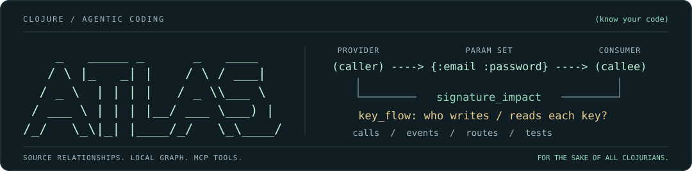

# clojure-atlas

**Agentic kodlama için geliştirildi. AI ajanınıza Clojure kod tabanınızın haritasını verin.**

Çağıranları ve veri sağlayıcılarını/tüketicilerini izleyin, fonksiyon sözleşmelerini **map argümanlarının içindeki anahtarlara kadar**
inceleyin, re-frame event'lerini ve route'ları takip edin, bir değişiklikten etkilenen testleri belirleyin.
clojure-atlas, **Clojure, ClojureScript ve `.cljc` kaynak kodunu** yerel bir kod grafiğine dönüştürür ve bunu kaynak konumları
ve açık güven seviyeleriyle **13 MCP aracı** olarak sunar.

**Kodlama ajanları için yardımcı bir araç** olarak geliştirildi: Atlas, kodu değiştirmeden önce ajanların ihtiyaç duyduğu
yapısal bağlamı sağlar: kodun neye bağlı olduğu, tüketicilerinin hangi parametreleri ve map anahtarlarını beklediği ve hangi
testlerin onunla ilgili olduğu.



[](LICENSE)
[](#gereksinimler)
[](#hızlı-başlangıç)
[](#tasarım-gereği-yerel)

**Zorunlu npm çalışma zamanı bağımlılığı yok. Yerel analiz. For the sake of all Clojurians. (Tüm Clojure'cular için.)**

**Barış Can Ateş**'in kişisel projesi · MIT lisanslı · [clj-kondo](https://github.com/clj-kondo/clj-kondo) üzerine kurulu.

[English](README.md) | Türkçe | [Deutsch](README.de.md) | [Español](README.es.md) | [Português (Brasil)](README.pt-BR.md) | [日本語](README.ja.md) | [简体中文](README.zh-CN.md)

[Yetenekler](#neler-yapabilirsiniz) · [Map sözleşmeleri](#map-anahtarlarına-kadar-sözleşmeler) · [Desteklenen yığın](#diller-ve-ekosistem-desteği) · [Örnekler](#çalışırken-görün) ·
[Hızlı başlangıç](#hızlı-başlangıç) · [Kapsam](#kapsam) · [Nasıl test edilir](#atlas-nasıl-test-edilir) · [Tam kılavuz](docs/GUIDE.md)

## Neler yapabilirsiniz

Tanımadığınız bir projeyi keşfederken, bir refactor planlarken veya bir değişikliği incelerken kullanın. MCP istemciniz
araçları çağırır; Atlas, kurabildiği ilişkileri `file:line` atıflarıyla döndürür.

| Ajanınıza sorun… | Atlas ona şunu verir… | MCP araçları |
|---|---|---|
| “Bunu kim çağırıyor ve değişikliğim neleri etkileyebilir?” | Doğrudan çağıranlar, değer referansları ve dolaylı bağımlılar | `callers`, `blast_radius` |
| “Her çağıran hangi parametre kümesini veriyor ve fonksiyon neyi okuyor?” | Arity'ler, destructure edilen map anahtarları, varsayılan değerler, keyword argümanlar ve her çağrı noktasında verilen anahtarlar | `signature_impact` |
| “Bu map anahtarını kim sağlıyor, kim tüketiyor?” | İç içe map'lerdeki literal anahtarlar ve anahtar yolları dahil anahtar üreticileri ve tüketicileri | `key_flow` |
| “Bu yapılandırma satırında eksik bir anahtar var mı?” | Kardeş map satırlarında bulunup bunda olmayan anahtarlar | `key_siblings` |
| “Bu endpoint'i ne işliyor? İzin nerede kontrol ediliyor?” | Route handler'ları, sıralı middleware'ler ve yapılandırılmış izin kontrolleri | `route_authz`, `permission_routes` |
| “Bu re-frame event'i tetiklenince ne olur?” | Dispatch'ler, handler'lar, subscription'lar ve HTTP istekleri | `event_flow` |
| “Bu veritabanı attribute'unu kim okuyor ya da yazıyor?” | Kanıtlanmış okuma ve yazmalar; belirsiz referanslar görünür tutulur | `attribute_usage` |
| “Hangi testler bu değişiklikle ilgili?” | Statik birim testi bağlantıları, Playwright bağlantıları ve değişen dosya veya satırlar için bir inceleme bağlamı | `tests_for`, `tests_covering`, `context_for_change` |
| “Bu graf aslında neyi biliyor?” | Kaynak commit, etkin adaptörler, kanıt sayıları ve kapsam uyarıları | `graph_info` |

Bir çağrı, bir callback ve aynı yazılışa sahip bir keyword farklı şeylerdir. Atlas bu ayrımları modeller;
Clojure'un kayıtlarını (registration) ve veri odaklı bağlantılarını da buna dahildir. Ajanınıza, düzenlemeden önce inceleyebileceği kanıt verir.

### Yayına çıkmadan önce yakalamanıza yardımcı olduğu hatalar

Her satır, herkese açık bir projedeki gerçek bir yanıttır; tam döküm için bağlantıyı izleyin.

| Olası hata | Şununla sorun | Atlas ne gösterdi (gerçek örnek) |
|---|---|---|
| Bir yapılandırma veya veri satırında kardeş satırlarının sahip olduğu bir anahtar eksik | `key_siblings` | re-frame: bir query tablosunun 2 satırında, 4 kardeş satırın 3'ünde bulunan `:re-frame/lifecycle` yok ([döküm](docs/GUIDE.md#key_siblings)) |
| Yeni zorunlu bir anahtar mevcut çağıranları bozuyor | `signature_impact` ile `added_keys` | polylith-realworld: `login!` `:tenant-id` isterse, 3 çağıran onsuz bir literal map geçiyor ve 1 çağıran Atlas'ın göremediği bir map'i iletiyor ([döküm](#bir-map-argümanının-içindeki-sözleşmeyi-inceleyin)) |
| Bir çağıran yanlış arity geçiyor, ya da fonksiyonun hiç okumadığı bir anahtar geçiyor, ya da destructure ettiği bir anahtarı atlıyor | `signature_impact` | integrant: `init`, 38 çağıran ve her iki arity'ye karşı kontrol edildi; yapılan aramalar adıyla belirtilerek “no finding” ([döküm](docs/GUIDE.md#signature_impact)) |
| Bir endpoint'te middleware veya izin kontrolü eksik | `route_authz`, `permission_routes` | polylith-realworld: `POST /api/articles` ve 11 sarmalayıcısı sırayla, en son `wrap-authorization`; bildirilmiş bir model olmadan izinler dürüstçe “not extracted” ([döküm](docs/GUIDE.md#route_authz)) |
| Hiçbir şeyin yazmadığı bir anahtar okunuyor (çoğunlukla bir yazım hatası veya yeniden adlandırılmış anahtar) | `key_flow` | compojure: `:compojure/path` için 1 üretici (`assoc-path`) ve 2 tüketici var ([döküm](docs/GUIDE.md#key_flow)) |
| Bir veritabanı attribute'unu yazan beklenmedik bir yazıcı | `attribute_usage` | mount: `:order/bid` için kanıtlanmış 2 yazıcı var, biri test kodunda, okuyucu yok ([döküm](docs/GUIDE.md#attribute_usage)) |
| Dispatch edilen bir event'in handler'ı yok, ya da bir handler beklenmedik event'ler tetikliyor | `event_flow` | re-frame todomvc: `:delete-todo` 2 noktadan dispatch ediliyor, bir kez işleniyor, hiçbir şey tetiklemiyor ([döküm](docs/GUIDE.md#event_flow)) |
| Küçük bir değişiklik beklenenden daha uzağa yayılıyor | `blast_radius` | integrant: `ref?` üzerindeki bir değişiklik 6 seviyede 31 tanıma ulaşıyor ([döküm](docs/GUIDE.md#blast_radius)) |
| Hiçbir testin ulaşmadığı değişen kod | `context_for_change`, `tests_for` | polylith-realworld: article store'un 60-80. satırları 3 tanıma, 9 dış çağırana ve 24 ilgili teste dokunuyor ([döküm](docs/GUIDE.md#context_for_change)) |

Atlas bakılacak yeri gösterir; bunun bir hata olup olmadığına karar vermek size veya ajanınıza kalır.

### Bir ajanın iş akışı

1. **Yönelin:** anlık görüntüyü, etkin adaptörleri ve analiz boşluklarını kontrol etmek için `graph_info` kullanın.
2. **Araştırın:** çağıranları, parametre sözleşmelerini, map anahtarı sağlayıcılarını/tüketicilerini ve bir değişikliğin olası etkisini inceleyin.
3. **Planlayın ve doğrulayın:** etkilenen kodu ve ilgili testleri bulmak için `context_for_change` ve test araçlarını kullanın;
   atıf yapılan kaynağı inceleyin, değişikliği yapın ve ilgili testleri çalıştırın. Sonraki tur için grafı yeniden oluşturun ve MCP sunucusunu yeniden başlatın.

## Map anahtarlarına kadar sözleşmeler

Atlas, **kaynakta görünen parametre sözleşmesini** incelenebilir kılar: bir çağıranın ne verdiği, bir fonksiyonun neyi
destructure ettiği veya okuduğu ve önerilen bir değişikliğin hangi çağrı noktalarını etkilediği.

| Seviye | Atlas ne gösterebilir |
|---|---|
| **Parametre kümesi** | Kabul edilen arity'ler, konumsal/rest parametreler ve `& {:keys [verbose]}` gibi keyword argümanlar |
| **Map argümanının içindeki anahtarlar** | `{:keys [email password]}`, `:or` varsayılanları, `:as` takma adları, çağıranların verdiği literal anahtarlar ve fonksiyon gövdesindeki desteklenen okumalar |
| **Sağlayıcı / tüketici** | Map literal'leri, `assoc` ve `assoc-in` gibi üreticiler; destructuring, keyword erişimi, `get` ve `get-in` gibi tüketiciler |
| **Sözleşme değişiklikleri** | `signature_impact` ile `added_keys`, `removed_keys`, `arities` veya `base_graph` kullanılarak eklenen/kaldırılan anahtarlardan ya da değişen arity'lerden etkilenen çağrı noktaları |
| **İç içe map'ler** | `key_flow` aracılığıyla iç içe map'lerdeki literal anahtar geçişleri, destructuring ve `(get-in cart [:meta :count])` gibi yollar |

Kapsam **statik anahtar kullanımıdır**, değer/tip doğrulaması değil. `key_flow`, geçişleri belirli bir map'in kimliğine göre değil,
keyword'e göre gruplar. `signature_impact`, iç içe destructuring veya `get-in` için dış anahtarı kaydeder, tam bir
iç içe şemayı değil. Çalışma zamanında oluşturulan map'ler ve anahtarlar bilinmez kalabilir.

## Diller ve ekosistem desteği

**Çekirdek diller:** Clojure (`.clj`), ClojureScript (`.cljs`) ve paylaşılan kod (`.cljc`). EDN dosyaları, desteklenen
yapılandırma ve veri formlarına katkıda bulunur. TypeScript (`.ts`) yalnızca isteğe bağlı Playwright entegrasyonu için okunur;
bu, genel amaçlı bir JavaScript ya da TypeScript analizörü değildir.

| Alan | Tanınan kütüphaneler / formlar | Bugün neler kapsanıyor |
|---|---|---|
| Çekirdek Clojure | Var'lar, çağrılar, değer kullanımları, callback'ler, multimethod'lar, protocol'ler | Tanımlar ve bağımlılık ilişkileri; dispatch adayları sezgiseldir |
| Parametre ve map sözleşmeleri | `defn` arity'leri, map destructuring, keyword argümanlar, map literal'leri ve anahtar işlemleri | Çağıranın verdiği anahtar kümeleri, tüketilen anahtarlar, sağlayıcı/tüketici noktaları ve imza değişikliği etkisi |
| Frontend durumu | **re-frame**, `re-frame.alpha` dahil | Event/subscription kayıtları, dispatch, subscription girdileri ve subscriber'lar |
| Backend yönlendirme | **Compojure**, **Reitit**, **Pedestal** tablo route'ları | Yollar, bağlanmış route kopyaları ve handler'lar; Pedestal service-map interceptor'ları çıkarılmaz |
| Middleware | **Ring**, Compojure `wrap-routes`, Reitit route verisi ve `ring-handler` | Dıştaki sarmalayıcılar dahil sıralı zincirler; çıkarım yapılan zincirler sezgisel olarak işaretlenir |
| Route yetkilendirmesi | Projede tanımlı izin anahtarları, middleware'ler ve fonksiyonlar | Küçük bir `.clojure-atlas.edn` bildirimi gerektirir |
| Tarayıcı yönlendirme | **Reitit frontend**, **Secretary** | Grafta istemci route düğümleri; bunları listeleyen özel bir MCP aracı henüz yok |
| HTTP istekleri | **cljs-ajax**, **cljs-http**, `js/fetch`, istek effect map'leri | İstek noktaları ve backend route'larıyla metot ve yola göre eşleşmeler |
| Veri | **Datomic**, **DataScript**, **XTDB v1 / Crux** | Attribute'lar, transaction yazmaları, query/pull okumaları ve belirsiz referanslar |
| Sistem yaşam döngüsü | **Integrant**, **Mount**, **Component** | Sistem anahtarları, kayıtlar ve bağımlılık kenarları; Integrant yapılandırma çıkarımı ref'lere dayanır |
| Şemalar | **clojure.spec / cljs.spec**, **Malli** | Kayıtlı spec şemaları ve var'larda tutulan Malli şemaları; Malli registry'leri desteklenmez |
| Testler ve UI | **clojure.test / cljs.test**, **Playwright**, literal Hiccup seçicileri | Statik test bağlantıları; Playwright page object'leri ve `.ts` testleri için isteğe bağlı TypeScript 5 gerekir |
| Proje düzeni | **deps.edn**, **Leiningen**, **shadow-cljs**, **Babashka**, **Boot**, **Polylith** düzenleri | Kaynak keşfi ve modül/component'e göre gruplama; build alias'ları ve görev çalıştırma analiz edilmez |

Framework adaptörleri belirli kaynak formlarını tanır, bir kütüphanenin olası her kullanımını değil. `graph_info`,
**sizin** projenizde nelerin mevcut olduğunu ve etkinleştirildiğini bildirir. Fulcro, Pathom, HoneySQL ve next.jdbc gibi depolar
ölçüm korpusundadır, ancak orada bulunmaları özel framework veya SQL analizinin uygulandığı anlamına **gelmez**.
Bu adaptörler, bidi, compojure-api ve diğer boşluklar için [yol haritasına](ROADMAP.md) bakın.

## Çalışırken görün

Bu alıntılar, herkese açık projelerin [commit edilmiş örnek graflarından](examples/) gelir. Çağrı bir
MCP araç çağrısıdır, kabuk komutu değil. `[S]` statik olarak kanıtlanmış, `[H]` sezgisel anlamına gelir.

### Bir map argümanının içindeki sözleşmeyi inceleyin

polylith-realworld'de `login!` **tek bir map argümanı** alır ve **`:email` ile `:password`** anahtarlarını destructure eder.
Atlas bu anahtar kümesini, çağıranlarının verdiği argümanların yanında gösterir:

```text
signature_impact {"fn": "clojure.realworld.user.core/login!", "group_by": "none"}
```

```text
SIGNATURE_IMPACT clojure.realworld.user.core/login! — 4 caller(s) in 1 component(s); arities 1; no finding
counts: arities=1 [S1]  callers=4 [S4]
[... trimmed ...]
arities (1)
  1. [{:keys [email password]}]  components/user/src/clojure/realworld/user/core.clj:50 [S]  (4 caller(s))
callers (4 S4)
  1. clojure.realworld.user.interface/login!: arity 1, arg0 symbol login-input (keys unknown)  components/user/src/clojure/realworld/user/interface.clj:6 [S]
  2. clojure.realworld.user.core-test/login--invalid-password--return-negative-result: arity 1, arg0 {:email :password}  components/user/test/clojure/realworld/user/core_test.clj:34 [S]
[... trimmed ...]
```

Literal map'in anahtar kümesi görünür; `login-input` olarak geçirilen map bilinmez kalır. O satırdaki `[S]`,
çağrı ilişkisini kanıtlar, çalışma zamanındaki map'in içeriğini değil.

<details>
<summary><strong>Parametre sözleşmesini değiştirin: login! ayrıca :tenant-id isterse ne olur?</strong></summary>

```text
signature_impact {"fn": "clojure.realworld.user.core/login!", "added_keys": [":tenant-id"], "group_by": "none"}
```

```text
SIGNATURE_IMPACT clojure.realworld.user.core/login! — 3 caller(s) affected by the change (new keys: :tenant-id); 4 caller(s) in 1 component(s); arities 1; no finding
counts: affected=4 [S3 ?1]  arities=1 [S1]  callers=4 [S4]
[... trimmed ...]
  1. clojure.realworld.user.core-test/login--invalid-password--return-negative-result does not pass :tenant-id  components/user/test/clojure/realworld/user/core_test.clj:34 [S]  (argument 0 passes {:email :password})
[... trimmed ...]
```

Üç literal-map çağıranın hepsi önerilen anahtarı atlıyor. Dördüncü çağıran `login-input`'u iletiyor, dolayısıyla
etkisi **UNKNOWN**'dur. Bu varsayımsal bir sözleşme değişikliğidir; araç kaynağı değiştirmez. “No finding”
mevcut imzayı ifade eder; `affected` bölümü önerilen değişikliği anlatır.

</details>

<details>
<summary><strong>Proje genelinde :email'in sağlayıcılarını ve tüketicilerini bulun</strong></summary>

```text
key_flow {"key": ":email", "group_by": "none", "limit": 2}
```

```text
KEY_FLOW :email — 9 producer(s), 5 consumer(s) in 1 component(s); 23 site(s) in tests
counts: producers=9 [S9]  consumers=5 [S5]  tests=23 [S23]
[... trimmed ...]
```

Sonuç, `register!` içindeki map-literal üreticilerini ve `login!` dahil destructuring tüketicilerini kaynak
konumlarıyla listeler. `:email` nitelikli olmadığından, bu keyword'ü kullanan her map birlikte gruplanır; bu,
belirli bir üreticinin map'inin belirli bir tüketiciye ulaştığını kanıtlamaz.

</details>

<details>
<summary><strong>Refactor öncesi çağıranları bulun</strong></summary>

**Soru:** `integrant.core/dependent-keys` fonksiyonunu kim çağırıyor?

```text
callers {"var": "integrant.core/dependent-keys"}
```

```text
CALLERS integrant.core/dependent-keys — 4 direct caller(s) in 1 component(s)
counts: callers=4 [S4]
definition (1)
  1. integrant.core/dependent-keys  src/integrant/core.cljc:211 [S]
callers (4 S4)
  1. integrant.core/build  src/integrant/core.cljc:442 [S]  fan-in 4
  2. integrant.core/load-namespaces  src/integrant/core.cljc:260 [S]
  3. integrant.core/halt-missing-keys!  src/integrant/core.cljc:673 [S]
  4. integrant.core/run!  src/integrant/core.cljc:389 [S]
next: blast_radius(var="integrant.core/dependent-keys", depth=2)  tests_for(symbol="integrant.core/dependent-keys")
```

</details>

<details>
<summary><strong>Bir re-frame event'ini dispatch noktaları ve handler'ı boyunca izleyin</strong></summary>

```text
event_flow {"name": ":delete-todo"}
```

```text
EVENT_FLOW :delete-todo — :delete-todo: dispatched from 2 site(s), 1 handler(s), fires 0 event(s) and 0 request(s)
counts: dispatched by=2 [S2]  handler=1 [S1]
note: events: switched on by re-frame.core
event :delete-todo: dispatched by (2 S2)
  examples/todomvc: 2
    1. todomvc.views/todo-item  examples/todomvc/src/todomvc/views.cljs:40 [S]
    2. todomvc.views/todo-item  examples/todomvc/src/todomvc/views.cljs:47 [S]
event :delete-todo: handler (1)
  1. :delete-todo event handler  examples/todomvc/src/todomvc/events.cljs:188 [S]  entry: event handler
[... trimmed ...]
```

Bağlantı bir event keyword'ü üzerinden kurulur; bu yüzden yalnızca adlandırılmış bir fonksiyonun çağıranlarına bakmak onu kaçırırdı.

</details>

<details>
<summary><strong>Bir endpoint'in önündeki middleware'i ve Atlas'ın neyi kontrol edemediğini görün</strong></summary>

polylith-realworld'den; burada route'lar ayrı bir tanımda Ring middleware ile sarmalanıyor:

```text
route_authz {"route": "POST /api/articles"}
```

```text
ROUTE_AUTHZ POST /api/articles — not provable: route authz not in this graph
counts: route=1 [S1]  handler=1 [S1]  middleware=11 [H11]
note: capability route_authz is absent: an empty answer is not proof of absence
[... trimmed ...]
  1. clojure.realworld.rest-api.handler/create-article  bases/rest-api/src/clojure/realworld/rest_api/api.clj:31 [S]  entry: route POST /api/articles @clojure.realworld.rest-api.api/private-routes
POST /api/articles @clojure.realworld.rest-api.api/private-routes (base clojure.realworld.rest-api.api/private-routes): middleware (outermost first) (11 H11)
  1. clojure.realworld.rest-api.middleware/wrap-cors  bases/rest-api/src/clojure/realworld/rest_api/api.clj:61 [H]  heuristic match  (#0 wrapper)
  2. ring.middleware.json/wrap-json-response  bases/rest-api/src/clojure/realworld/rest_api/api.clj:60 [H]  heuristic match  (#1 wrapper)
[... trimmed ...]
  10. clojure.realworld.rest-api.middleware/wrap-auth-user  bases/rest-api/src/clojure/realworld/rest_api/api.clj:46 [H]  heuristic match  (#9 wrapper)
  +1 more (next page: offset=10 section="middleware")
POST /api/articles @clojure.realworld.rest-api.api/private-routes (base clojure.realworld.rest-api.api/private-routes): permissions: not extracted (route_authz is absent)
```

Handler kanıtlanmıştır; on bir sarmalayıcı sırayla bulunur ancak `[H]` ile işaretlenir, çünkü middleware kompozisyonu
çalışma zamanı kodudur. Proje izin kuralı bildirmediğinden Atlas, route'un izin kontrolü olmadığını iddia etmek yerine
**not extracted** der.

</details>

<details>
<summary><strong>Dürüst bir ıskalama: kullanılan ama hiç tanımlanmayan bir ad</strong></summary>

next.jdbc'den; burada bir makro, clj-kondo'nun açamadığı yardımcı fonksiyonlar üretiyor:

```text
callers {"var": "next.jdbc.types/as-other"}
```

```text
CALLERS next.jdbc.types/as-other — no definition matches "next.jdbc.types/as-other"; used at test/next/jdbc/sql_test.clj:290, test/next/jdbc_test.clj:559 but no definition was found
note: next.jdbc.types/as-other is used at test/next/jdbc/sql_test.clj:290, test/next/jdbc_test.clj:559 but no definition was found: probably defined by a macro clj-kondo cannot expand; add :lint-as for the macro in .clj-kondo/config.edn
note: use a fully qualified name (ns/name)
```

“Bulunamadı, yazımı kontrol edin” demek yerine yanıt, adın nerede kullanıldığını ve nasıl görünür kılınacağını gösterir.
Makro için bir `:lint-as` girdisiyle aynı soru kanıtlanmış bir tanım döndürür
([proje yapılandırması](docs/GUIDE.md#project-configuration)).

</details>

<details>
<summary><strong>Değişen satırları inceleme bağlamına ve ilgili testlere dönüştürün</strong></summary>

polylith-realworld'den:

```text
context_for_change {"changes": ["components/article/src/clojure/realworld/article/store.clj:60-80"]}
```

```text
CONTEXT_FOR_CHANGE components/article/src/clojure/realworld/article/store.clj:60-80 — 1 file(s), 3 changed symbol(s), 0 route(s), 0 attribute(s); risk LOW
counts: changed symbols=3 [S3]  callers outside the diff=9 [S9]  tests to run=24 [S24]
[... trimmed ...]
```

Tam yanıt; üç değişen tanımı, diff dışındaki dokuz çağıranı ve component'lere göre gruplanmış 24 ilgili testi listeler.
`LOW`, grafın yaptığı kontrolleri tanımlar; bir güvenlik garantisi değildir.

</details>

[Daha fazla gerçek örnek](examples/README.md) · [Tüm araçlar ve tam çıktılar](docs/GUIDE.md#tools)

## Hızlı başlangıç

**Ön koşullar:** Node.js **22.18+** ve Git. JVM veya Babashka çalışma zamanı gerekmez.

### 1. Kurun ve bir graf oluşturun

**Analiz etmek istediğiniz Clojure projesinin** kök dizininden çalıştırın:

```sh
# Install the reviewed source revision (Git installation builds the CLI).
npm install --save-dev \
  'git+https://github.com/Bariscanates404/clojure-atlas.git#8634d33e3ed59d420eead61a9c596f752d1fe789'

npx clojure-atlas build
```

Paket şu anda npm'de yayımlanmış değildir; yukarıdaki Git kurulumunu kullanın. Depo özel olduğu sürece depoya erişim
gerekir. Kaynaktan kurulum, CLI'yi derlemek için TypeScript ve Node tip tanımlarını kullanır; bunlar derleme zamanı
bağımlılıklarıdır ve zorunlu npm çalışma zamanı bağımlılığının olmamasından ayrıdır.

Graf `.clojure-atlas/graph.json.gz` dosyasına kaydedilir. İlk build, sabitlenmiş clj-kondo ikili dosyasını indirir ve doğrular;
sonraki analizler önbellekteki ikili dosyayı kullanır. `.clojure-atlas/` dizinini projenizin `.gitignore` dosyasına ekleyin.

### 2. MCP istemcinizi bağlayın

Claude Code için proje yapılandırmasını önce önizleyin, sonra yazın:

```sh
npx clojure-atlas init         # preview .mcp.json
npx clojure-atlas init --yes   # write it; keep existing servers
```

Sunucuyu istemcinizde etkinleştirin, ardından projenizdeki tam nitelikli bir `ns/name` üzerinde `graph_info` ve `callers`
kullanmasını isteyin.

<details>
<summary><strong>Başka bir MCP istemcisini yapılandırın</strong></summary>

Atlas **stdio üzerinden MCP** kullanır. İstemciyi, onu proje kökünüzden başlatacak şekilde yapılandırın:

```json
{
  "mcpServers": {
    "clojure-atlas": {
      "command": "npx",
      "args": ["clojure-atlas", "mcp", "--graph", ".clojure-atlas/graph.json.gz", "--repo", "."]
    }
  }
}
```

İstemci sunucuları başka bir yerde başlatıyorsa, kurulu CLI, graf ve depo için istemcinin çalışma dizini ayarını
veya mutlak yolları kullanın. İstemci yapılandırma biçimleri farklılık gösterebilir.

</details>

### 3. Değişikliklerden sonra yeniden oluşturun

```sh
npx clojure-atlas build       # refresh the snapshot
npx clojure-atlas coverage   # inspect resolution counts and unresolved names
```

İzleme (watch) modu yoktur. `--repo` ile, çalışma ağacı artık grafla eşleşmediğinde sorgular `STALE` uyarısı verir.
Yeni grafı yüklemesi için yeniden oluşturduktan sonra MCP sunucusunu yeniden başlatın.

**Zaten clj-kondo yapılandırmanız var mı?** Atlas, projenin `.clj-kondo/config.edn` dosyasını, makro eşlemeleri ve
hook'ları dahil uygular. İsteğe bağlı bir `.clojure-atlas.edn`, özel route makroları ve yetkilendirme kuralları ekler.
[Proje yapılandırması](docs/GUIDE.md#project-configuration) ve [yetkilendirme fixture'ı](test/fixtures/authz/.clojure-atlas.edn) bölümlerine bakın.

## Bir yanıt nasıl okunur

| İşaret | Anlamı | Nasıl kullanılır |
|---|---|---|
| `[S]` — `STATIC_PROVEN` | clj-kondo tarafından çözümlendi veya literal bir kaynak formundan belirlendi | Atıf yapılan kaynak konumunu izleyin |
| `[H]` — `HEURISTIC` | Bir addan, sarmalayıcıdan, thread edilmiş yuvadan veya dispatch adayından çıkarıldı | İlişkiyi kaynakta doğrulayın |
| `[?]` — `UNKNOWN` | Statik olarak karara bağlanamaz | Bunu bir analiz sınırı olarak değerlendirin |

**Boş bir sonuç otomatik olarak yokluğun kanıtı değildir.** Atlas “hiçbiri bulunamadı”, “tanım bulunamadı” ve “yetenek
mevcut değil” durumlarını birbirinden ayırır. `DEGRADED` eksik analizi, `STALE` güncelliğini yitirmiş bir anlık
görüntüyü bildirir. Sıfır test sayısı, statik bir bağlantı bulunmadığı anlamına gelir; kodun test edilmediği anlamına gelmez.

Dinamik dispatch, çalışma zamanında oluşturulan sembol'ler ve proje makroları grafın görebildiklerini sınırlayabilir. Okunamayan
middleware unknown olarak bildirilir. Route izinleri açık proje yapılandırması gerektirir.
[Kanıt ve yokluk](docs/GUIDE.md#bands-and-absence) · [Bilinen sınırlar](docs/GUIDE.md#limits)

## Tasarım gereği yerel

Çekirdek CLI'nin **zorunlu npm çalışma zamanı bağımlılığı yoktur**. Node'un standart kütüphanesini, Clojure analizi için
clj-kondo'yu ve depo meta verileri için Git'i kullanır. Grafı yerel olarak oluşturur ve sorgular; Atlas hesabı, barındırılan
dizin veya bulut hizmeti gerekmez.

### Gereksinimler

| Bileşen | Rol |
|---|---|
| Node.js 22.18+ | CLI'yi ve MCP sunucusunu çalıştırır |
| clj-kondo 2025.10.23 | Yerel analizör; bir kez indirilir ve önbelleğe alınır, arşiv SHA-256'sı sabitlenmiştir |
| Git | Kaynaktan kurulum, izlenen dosya kontrolleri ve anlık görüntü/eskime bilgisi |
| TypeScript 5 — çalışma zamanında isteğe bağlı | Playwright page object ve test analizi; Atlas'ın yanına `npm i -D typescript@5` ile kurun |

Sabitlenmiş ikili dosyalar macOS arm64/x64, Linux arm64/x64 ve Windows x64 için mevcuttur. Geliştirme ve korpus
ölçümlerinde macOS arm64 kullanıldı; **Windows test edilmemiştir**. İndirme mümkün değilse, bir proxy arkasında olmak
dahil, Atlas `PATH` üzerindeki çalışan bir `clj-kondo`'ya geri dönebilir. [Platform ve önbellek ayrıntıları](docs/GUIDE.md#requirements).

### Güvenlik

Küçük bir bağımlılık yüzeyi yardımcı olur, ancak **zorunlu npm bağımlılığının olmaması sıfır tedarik zinciri riski anlamına gelmez**.

- İndirilen clj-kondo arşivleri sabitlenmiş bir SHA-256'ya karşı kontrol edilir. Eşleşmeyen bir indirme reddedilir;
  `PATH` üzerindeki yedek çalıştırılabilir dosyaya ayrıca güvenilir ve o sabitlenmiş arşiv karmasına karşı doğrulanmaz.
- Atlas, analiz edilen uygulamanın JVM'ini, kabuk betiklerini veya Node kodunu başlatmaz. **Proje clj-kondo hook'ları
  clj-kondo tarafından yorumlanır**, dolayısıyla bir depoyu analiz ederken yapılandırması güvendiğiniz kodun parçasıdır.
- MCP sunucusu grafı okur ve salt okunur Git kontrolleri kullanır. Bu kontroller için Git komut hook'ları, filtre sürücüleri
  ve fsmonitor devre dışıdır; Git ve clj-kondo alt süreçlerinin zaman aşımı vardır.
- Atlas sonuçları yerel olarak stdio üzerinden sunar. Seçtiğiniz AI/MCP istemcisinin bu sonuçları nasıl ele aldığı ayrı
  bir gizlilik sınırıdır.

Bunlar uygulama özellikleridir, bir güvenlik denetimi sertifikasyonu değildir. [Ayrıntılı yürütme modeli](docs/GUIDE.md#security).

## Kapsam

[corpus.json](corpus.json) içinde her biri bir commit'e sabitlenmiş **26 herkese açık depo** üzerinde ölçüldü. Korpus
Babashka, Logseq, Metabase, Penpot, re-frame, Reitit ve daha küçük kütüphaneleri içerir. Tam sonuçlar
[docs/COVERAGE.md](docs/COVERAGE.md) içindedir.

**Çözümleme oranı belirli bir şeyi ölçer:** tanınan proje ad alanlarına atfedilen var kullanımları için
`resolved / (resolved + unresolved)`. Kütüphane kullanımları ve **bilinmeyen ad alanı kullanımları bu paydanın dışındadır**.
Anlaşılan tüm kodu, çıkarılan tüm framework davranışını veya çalışma zamanı doğruluğunu ölçmez.

| Depo | Resolved | Unresolved | Çözümleme oranı | Bilinmeyen ad alanı (ham sayı, hariç) |
|---|---:|---:|---:|---:|
| Metabase | 311,181 | 111 | 100.0% | 9,522 |
| Penpot | 124,814 | 13 | 100.0% | 1,888 |
| Logseq | 69,041 | 0 | 100.0% | 162 |
| Babashka | 15,264 | 61 | 99.6% | 2,176 |
| XTDB v1 | 11,437 | 3 | 100.0% | 483 |
| shadow-cljs | 5,051 | 16 | 99.7% | 909 |
| Reitit | 3,654 | 0 | 100.0% | 14 |
| re-frame | 2,629 | 0 | 100.0% | 47 |
| polylith-realworld | 871 | 0 | 100.0% | 0 |
| Integrant | 442 | 0 | 100.0% | 0 |
| DataScript † | 4,392 | 496 | 89.9% | 1,255 |
| day-of-datomic † | 84 | 29 | 74.3% | 1 |
| **Tüm 26 depo** | | | **medyan 100.0%; 26 depodan 24'ü 99.3% veya üzeri** | |

† [docs/COVERAGE.md](docs/COVERAGE.md#repos-under-95-resolution-rate-or-with-unknown-namespace-usages-above-5-of-resolved)

Oranlar bir ondalığa yuvarlanmıştır. Bunları her zaman **hem** unresolved hem de bilinmeyen ad alanı sayılarıyla birlikte okuyun.
Bilinmeyen adlar, kaçırılan var kullanımlarının yanı sıra alışılmadık makrolarla bağlanan yerel değişkenleri de içerebilir; analizör
bunları güvenilir biçimde ayıramaz.

**Metrik değişiklikleri analizör iyileştirmesi değildir.** Önceki rakamlar farklı bir payda kullanıyordu. Babashka'nın
bildirilen daha yüksek oranı büyük ölçüde bilinmeyen ad alanı sembollerinin dışarıda bırakılmasını yansıtır, yeni çözümlenen kodu değil.
Bu tanımlar arasındaki karşılaştırmalar denk değildir; yukarıdaki ham sayılar bilerek görünür bırakılmıştır.

### Gerçek çıkarım iyileştirmeleri

Bunlar, çözümleme oranı tanımından ayrı olarak, Atlas'ın okuyabildiği şeydeki somut değişikliklerdir:

| İyileştirme | Gözlemlenebilir sonuç | Kanıt |
|---|---|---|
| Dıştaki Ring/Compojure middleware'ini okuma | polylith-realworld: `POST /api/articles` için **0 → 11** middleware girdisi | [Benchmark q13](docs/BENCHMARK.md#positive-questions), [fixture](test/fixtures/ring-middleware/) |
| Başka bir ad alanındaki frontend route tablolarını okuma | Logseq: **0 → 17** istemci route düğümü | [Kapsam](docs/COVERAGE.md), [benchmark q14](docs/BENCHMARK.md#positive-questions) |
| `re-frame.alpha`'yı tanıma | Alpha ad alanı üzerinden yapılan kayıtlar ve dispatch'ler çıkarılır | [Benchmark geçmişi](docs/BENCHMARK.md), [fixture](test/fixtures/reframe/src/app/alpha.cljs) |
| Projenin clj-kondo yapılandırmasını uygulama | Projenin makro eşlemeleri ve hook'ları analize katılır | [Yapılandırma fixture'ı](test/fixtures/project-config/), [testler](test/config.test.ts) |

### Benchmark

Kayıtlı benchmark **14/14 pozitif soruyu** ve **7/7 yokluk sorusunu** geçer; beklenen yanıtlar kaynağa karşı elle
kontrol edilmiştir. Bu, küçük bir regresyon benchmark'ıdır, genel bir doğruluk tahmini değildir. On üç pozitif yanıt
MCP araçlarını kullanır; istemci route sorusu graf düğümlerini doğrudan okur, çünkü henüz istemci route'larını listeleyen bir araç yoktur.
[Sorular, sonuçlar ve metodoloji](docs/BENCHMARK.md).

## Atlas nasıl test edilir

Ajanların güvendiği bir araç ilişki uydurmamalıdır. Bu sürümden önce kod şunlardan geçti:

| Kontrol | Sonuç |
|---|---|
| Otomatik testler | **831**, hepsi geçiyor; düzeltilen her hatanın, düzeltmeden önce başarısız olan bir testi var |
| Kaynak satır kapsamı | **99.75%**; CI 98%'in altında başarısız olur |
| Hata avları | Modül başına bir inceleyici, çalıştırılabilir yeniden üretimlerle yanlış yanıtları aradı; **85** kanıtlanmış hata bulundu ve düzeltildi |
| Bağımsız incelemeler | Kodu yazmamış inceleyicilerce **altı** tur; modül başına doğruluk, temizlik, kurallar ve testler puanlandı, her modül 5 üzerinden en az 4 alana kadar |
| Gerçek depolar | **26** herkese açık proje çökme olmadan ve **0** düşen kenarla derleniyor (altısında önceden 690'dı) |
| Güvenilmeyen depolar | Düşmanca fixture'lar; Git ayarlarının, filtre sürücülerinin, submodule'lerin, proje TypeScript'inin, tuhaf dosya adlarının ve takılan clj-kondo hook'larının hiçbir şey çalıştırmadığını ve hiçbir şeyi kilitlemediğini kontrol eder; çalıştırılabilir dosya araması depo dizinini atlar (birim testli; Windows'un kendisi test edilmemiştir) |
| Referans doğruluk | Yukarıdaki [benchmark](docs/BENCHMARK.md): 14 pozitif ve 7 yokluk sorusu, yanıtlar elle kontrol edildi |

En önemlileri yokluk soruları: Atlas'ın, “yok” gibi okunan boş bir liste yerine, gerçek bu olduğunda “not found”, “not extracted”
veya “degraded” dediğini kontrol ederler.

## Katkıda bulunma

**Let's build our Clojure X-ray tool together! (Clojure röntgen aracımızı birlikte geliştirelim!)**

Yararlı bir katkı, küçücük bir Clojure örneğiyle başlayabilir: “bu kütüphane şu iki şeyi birbirine bağlıyor ve Atlas
bunu görmeli.” Bir fixture ile beklenen graf satırlarını ekleyin ya da adaptörünün yazılmasına yardım edin. İkisi de memnuniyetle karşılanır.

```sh
npm ci
npm test
npm run test:coverage   # 98% source line-coverage gate
npm run typecheck
```

CLI, Node ile kolay dağıtım için TypeScript ile yazılmıştır; Clojure analizini clj-kondo yapar.
[Katkıda bulunma kılavuzu](CONTRIBUTING.md) · [Yol haritası](ROADMAP.md) · [Araç referansı](docs/GUIDE.md)

## Katkı verenler ve lisans

**Barış Can Ateş** tarafından oluşturuldu. Bu depodaki belgeler ve özgün çizimler dahil [MIT lisanslıdır](LICENSE).
Michiel Borkent'in **[clj-kondo](https://github.com/clj-kondo/clj-kondo)** projesi üzerine kurulmuştur;
kodlama ajanlarına arayüz olarak **[MCP](https://modelcontextprotocol.io)** kullanır. Korpus ve örneklerde kullanılan herkese açık
projelerin yazarlarına teşekkürler. Bu projeler ve bağımlılıklar kendi lisanslarını korur.

*For the sake of all Clojurians.*
